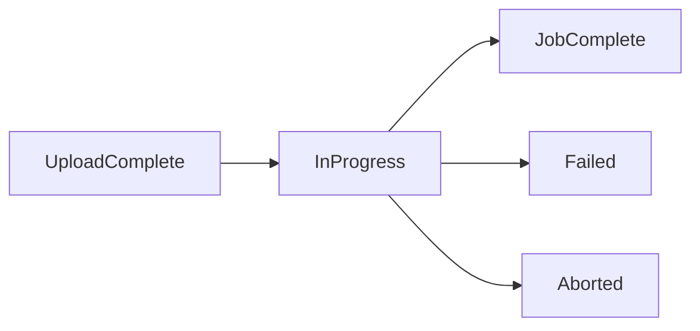

# Async Operations Reference

## Which operations are asynchronous

| Domain | Trigger | Status endpoint |
| --- | --- | --- |
| Data 360 ingestion | `POST /api/v1/ingest/jobs` | `GET /api/v1/ingest/jobs/:jobId` |
| Query API v2 | `POST /api/v2/query` | `GET /api/v2/query/:nextBatchId` |
| Segment publish | `PATCH /ssot/segments/:name` | `GET /ssot/segments/:name` |
| Data transforms | `POST /ssot/data-transforms` | `GET /ssot/data-transforms/:id` |
| ML predictions | `POST /ssot/machine-learning/...` | `GET /ssot/machine-learning/...` |
| Data kit deployment | `POST /ssot/data-kits/...` | `GET /ssot/data-kits/...` |
| Bulk API 2.0 | `sf data import bulk --async` | `sf data resume --job-id` |

## Polling pattern

The MCP server's `mcnext_poll_job` stopped when the response stopped changing,
when a configured success/failure value matched, or at a timeout — and always
returned the last payload plus the full status history. Reproduce that shape.

**Status fields are not at the top level.** Responses are usually wrapped
(`{"segments":[{...}]}`) and the status key varies by domain — `publishStatus`
for segments, `status` for ingestion jobs. Search the payload for any
status-like key rather than assuming a path:

```bash
# Extract the first status-like value anywhere in the JSON.
status_of() {
  python3 -c "
import json, sys
STATUS_KEYS = ('status', 'state', 'publishStatus', 'jobStatus', 'runStatus')
def walk(o):
    if isinstance(o, dict):
        for k, v in o.items():
            if k in STATUS_KEYS and isinstance(v, str):
                return v
        for v in o.values():
            r = walk(v)
            if r: return r
    elif isinstance(o, list):
        for v in o:
            r = walk(v)
            if r: return r
    return ''
try:
    print(walk(json.load(sys.stdin)))
except Exception:
    print('')"
}

poll_job() {
  local path="$1" tenant_flag="${2:-}" max="${3:-30}" interval="${4:-5}"
  local prev="" resp="" status="" i

  for ((i=1; i<=max; i++)); do
    resp=$(./scripts/sf-api.sh $tenant_flag --path "$path" 2>/dev/null || true)
    status=$(printf '%s' "$resp" | status_of)

    printf '[%d/%d] status=%s\n' "$i" "$max" "${status:-<none>}" >&2

    case "$status" in
      SUCCESS|SUCCEEDED|COMPLETED|ACTIVE|JobComplete|FAILED|ERROR|CANCELLED|Aborted) break ;;
    esac
    # Stop if the payload has stopped changing.
    [[ "$resp" == "$prev" && -n "$prev" ]] && { printf 'no change; stopping\n' >&2; break; }
    prev="$resp"
    sleep "$interval"
  done

  printf '%s\n' "$resp"
}
```

Usage:

```bash
poll_job "/ssot/ingest/jobs/$JOB_ID" "" 30 5
poll_job "/ssot/segments/My_Segment" "" 20 5
poll_job "/api/v2/query/$BATCH_ID" "--tenant" 20 3
```

## Status vocabularies

The catalog does not document one vocabulary, so match on what the endpoint
actually returns rather than assuming. Verified field names:

| Domain | Status field | Success | Failure |
| --- | --- | --- | --- |
| Segment publish | `publishStatus` | `SUCCESS` | `ERROR` |
| Ingestion jobs | `status` | `SUCCESS` | `FAILED`, `CANCELLED` |
| ML predictions | `status` | `SUCCEEDED` | `FAILED` |
| Data transforms | `status` | `COMPLETED` | `FAILED` |
| Bulk API 2.0 | `state` | `JobComplete` | `Failed`, `Aborted` |

Note that a segment also carries `segmentStatus` (`ACTIVE` / `DRAFT`), which
describes its lifecycle, not the outcome of the last publish. Use
`publishStatus` when waiting on a publish.

## Bulk API 2.0 job states



```bash
sf data resume --job-id 750... --target-org "$SF_TARGET_ORG" --json
```

## Timeouts and limits

| Setting | Suggested value |
| --- | --- |
| Poll interval | 3–5 seconds |
| Max polls | 20–30 |
| Total wait | 2–3 minutes before reporting back |

If a job has not settled within that window, report the last payload and the
status history rather than continuing to poll. A job that reports no change for
several consecutive polls is usually stuck, not slow.

## Caching

The MCP server cached successful `GET` responses (30 s default, 500 entries).
The CLI has no cache, so stale reads are not a failure mode. Cache deliberately
when you need to reduce call volume:

```bash
mkdir -p .cache
sf sobject describe -s Account -o "$SF_TARGET_ORG" --json > .cache/Account.json
rm -rf .cache   # when done
```

Never cache writes or error responses.

## Checking limits while polling

```bash
sf org list limits --target-org "$SF_TARGET_ORG" --json | python3 -c "
import json,sys
for l in json.load(sys.stdin)['result']:
    if 'Api' in l['name'] or 'Cdp' in l['name']:
        print(f\"{l['name']}: {l['remaining']}/{l['max']}\")"
```
