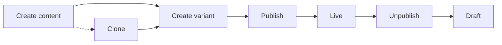

# Marketing Cloud Next Content API Reference

Base: `{instanceUrl}/services/data/v66.0`
Auth scope: `sfdc_cms_api`

## Search content in workspace

```
GET /connect/cms/items/search
```

| Parameter | Required | Type | Notes |
| --- | --- | --- | --- |
| `contentSpaceOrFolderIds` | yes | string | Workspace or folder id |
| `queryTerm` | no | string | Default `*` (all content) |
| `scope` | no | string | `All` or `TitleOnly` |
| `pageSize` | no | integer | Max 250 |

Response:

```json
{
  "count": 49,
  "currentPageUri": "/services/data/v65.0/connect/cms/items/search?page=0&pageSize=250",
  "items": [ { "id": "...", "title": "...", "contentKey": "..." } ]
}
```

## Content spaces

| Operation | Method | Path |
| --- | --- | --- |
| List spaces | GET | `/connect/cms/spaces` |
| Create space | POST | `/connect/cms/spaces` |
| Get space | GET | `/connect/cms/spaces/:contentSpaceOrFolderId` |
| Update space | PATCH | `/connect/cms/spaces/:contentSpaceOrFolderId` |

## Content items

| Operation | Method | Path |
| --- | --- | --- |
| Create content | POST | `/connect/cms/contents` |
| Get content | GET | `/connect/cms/contents/:contentKey` |
| Update variant | PUT | `/connect/cms/contents/variants/:variantId` |
| Delete variant | DELETE | `/connect/cms/contents/variants/:variantId` |
| Publish | POST | `/connect/cms/contents/publish` |
| Unpublish | POST | `/connect/cms/contents/unpublish` |
| Clone | POST | `/connect/cms/contents/:contentKey/clone` |

## Lifecycle



Creating content does not publish it. Publish is a separate call, and
unpublishing returns the item to draft without deleting it.

## Error codes

| Code | Meaning |
| --- | --- |
| `MISSING_ARGUMENT` | `contentSpaceOrFolderIds` not supplied to search |
| `NOT_FOUND` | Content key or variant id does not exist |
| `INVALID_INPUT` | Malformed body — check field names against `describe` |
